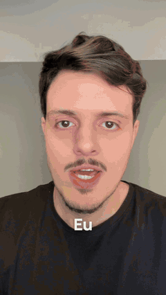

# Efeitos prontos

Os mesmos efeitos do editor que a Nomics usa nos próprios reels, abertos aqui. Você não precisa saber o nome técnico:
peça em português, do jeito que vier, e diga **em que palavra** ele entra. A IA ancora cada efeito na sua fala.

Vitrine feita com este editor, de ponta a ponta, acelerada 1,5× ([com som e no tempo real](img/efeitos.mp4)).

## Regra de ouro
Um efeito grande a cada 6 segundos, no máximo. Três a cinco por vídeo bastam. Efeito que não ilustra a frase daquele
momento é enfeite: a IA tira.

## Os efeitos

| Efeito | O que faz | Quando usar | Como pedir |
|---|---|---|---|
| **Print vivo** (`print`) | O print do assunto entra numa janela de navegador em 3D, com sombra; a página rola, um cursor anda até o trecho, clica e um marca-texto (ou uma caixa) se desenha na palavra | explicar site, ferramenta, artigo, repositório | "Quando eu falar *referências*, mostra o print da página e marca o trecho *Copia o jeito da sua referência*." |
| **Tela do assunto** (`tela_assunto`) | Você desce para a parte de baixo, a sala some e a janela do assunto desce do alto, rolando, com luz de estúdio | o gancho: apresentar do que é o vídeo | "No começo, quando eu falar *gratuito*, a tela do site desce e eu vou para baixo." |
| **Checklist 3D** (`checklist`) | Uma placa de metal na parede, atrás de você, tica cada item na palavra em que é dito | quando você enumera passos ou o que algo faz | "Na parte do *ele tira*, faz um checklist: frases repetidas, começos errados, pausas." |
| **Holofote** (`holofote`) | A sala apaga, você fica sob um facho de luz e as palavras grandes entram atrás de você | a virada, a frase que você quer que fique | "Em *uma parte que eu achei muito massa*, apaga a luz e escreve isso atrás de mim." |
| **Comentário** (`comentario`) | O comentário com a palavra-chave se digita, é publicado e a sua resposta chega com o botão | o CTA "comenta X que eu te mando" | "No *comenta IA*, mostra o comentário sendo digitado e a minha resposta." |
| **Número que conta** (`contador`) | Um cartão de vidro escuro entra e o número conta de 0 até o valor, com pop no fim | um número forte dito em voz alta | "O número conta quando eu falar *377*." |
| **Hodômetro** (`hodometro`) | Tambores mecânicos na parede giram até o número | número grande com peso (seguidores, vendas, estrelas) | "Quando eu falar *437*, um hodômetro gira até 437 atrás de mim." |
| **Caixa** (`caixa`) | Um contorno na cor de destaque se desenha em volta de um trecho da tela | apontar um pedaço de print ou gravação | "Quando eu falar *baixar*, desenha uma caixa no botão de download." |
| **Logo no traço** (`traco`) | O logo da marca citada se desenha pela linha e depois preenche | a primeira vez que você cita uma ferramenta | "Quando eu falar *Claude Code*, desenha o logo do Claude." |
| **Texto cinético** (`cinetica`) | A frase entra letra a letra (subindo, montando ou digitando), com a palavra de destaque em itálico na sua cor | o CTA final, a frase de efeito | "No final, escreve *Comenta IA* grande na tela." |
| **Selo** (`selo`) | Uma pílula com um rótulo curto | dar nome ao que aparece ("Grátis", "Passo a passo") | "Quando eu falar *de graça*, coloca um selo *100% grátis*." |
| **Lista que acende** (`lista`) | Um cartão com os itens; cada um acende na palavra em que é dito | quando você cita 2 a 5 coisas em sequência | "Lista: o corte, o vídeo pronto, cada um acendendo quando eu falar." |
| **Antes e depois** (`antes_depois`) | O quadro vira "bruto do celular" (cor lavada, sem legenda) e uma linha com puxador varre e revela o editado | mostrar o que a edição faz | "Quando eu falar *bruto*, mostra o antes e depois da edição." |
| **Timeline em chamas** (`timeline_chamas`) | Uma timeline de edição se monta no ar acima da sua cabeça e pega fogo na palavra | falar de edição, de trabalho que some, de virada | "A timeline pega fogo quando eu falar *tela*." |

## Padrões novos (valem para todo vídeo)
- **Legenda que sobe:** cada palavra entra subindo de leve, sempre branca. A ênfase (3 a 5 palavras no vídeo) muda só o
  tamanho. Para a palavra parada: "legenda sem animação".
- **Som desenhado:** whoosh em cada troca de tela, clique em cada clique do cursor, pop quando o número pousa, tique em
  cada item, riser antes da virada, impacto no gancho. Tudo sintetizado no seu computador, sem arquivo de som de
  terceiros, sempre abaixo da sua voz.
- **Sem música por padrão.** Música só entra se você pedir e mandar o arquivo (ou disser qual usar, com licença livre).

## Mac e Windows
Cinco efeitos põem você **na frente** do que aparece (tela do assunto, checklist, holofote, hodômetro, timeline em
chamas). No Mac, o editor recorta você com o Vision da Apple, no seu computador. No Windows não há esse recorte: o
efeito sai inteiro, sem quebrar, só que por cima (no holofote, as palavras ficam na frente; na tela do assunto, você
desce dentro de uma janela de câmera). Todo o resto é igual nos dois.

## Prints para o print vivo
- Salve o print em `meus-videos/` ou mande junto com o vídeo. Página inteira serve: a janela rola até o trecho.
- Para marcar um trecho, diga o texto exato que está no print. No Mac a IA acha o lugar sozinha
  (`motor/achar_texto.py`); no Windows ela estima olhando a imagem com uma grade por cima.
- Página em inglês: a IA pergunta se você quer manter ou trocar por um card traduzido. Nunca inventa print.
